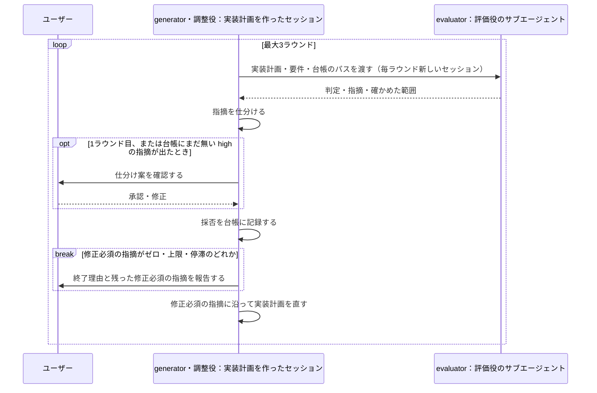
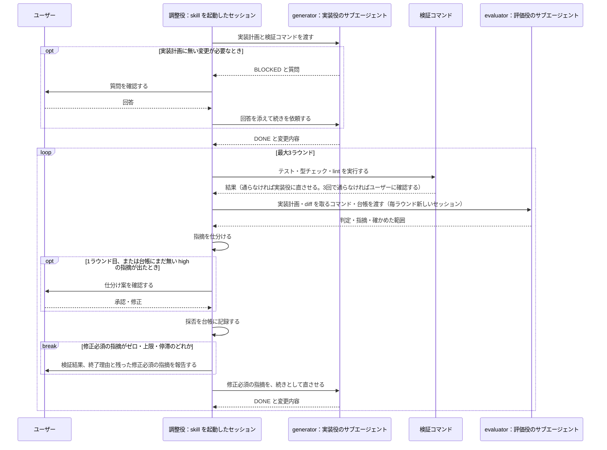

# レビュー・改善ループ skill の設計

## Context 背景

### skill が必要になった理由

この skill は、以下のような問題を解決するためのものである。

- 完成して見える実装計画にも欠落や誤りが残り、実装を始めてから気づいて手戻りになる[^keitakn][^claudex-first-run][^harness-design]
- Claude に自分の実装計画や実装を見直させても、甘い評価しか返らない[^harness-design]
- 実装の完了を、実装したエージェントの申告だけでは判断できない。
  報告されている失敗:
  - 動作を確かめないまま、終わったように見えた時点で作業を止める[^best-practices]
  - 頼まれていない実装が、それを肯定するテストと一緒に通る[^claudex-pr12]
  - 実装やレビューを担うエージェントが、実装計画やタスクで指定されたファイルしか確かめず、同じ欠陥を持つ別の書き込み元や、変更で失敗するようになった指定外のテストを見逃す[^claudex-pr12][^superpowers-release-notes]
- Codex に実装計画を渡し、指摘を Claude に戻す往復を手で行うのが手間。
  過剰な指摘の仕分けや、同じ指摘が続いて止めるべきかの判断も、毎回人間が行うことになる[^zenn-automation]
- 人間が見張っていないと誤りが放置されるので、その間に他の作業を進められない[^best-practices][^zenn-automation]

これらの問題を減らすため、evaluator-optimizer パターンを、実装計画のレビューと、実装のレビューに使う skill にしたい[^memo][^building-effective-agents]。
このパターンは、成果物を作る generator（生成役）と、それを評価する evaluator（評価役）を分け、evaluator のフィードバックで改善を繰り返す。

ただし、ループはどの実装計画にも見合うわけではない。
superpowers は、実装計画のレビューループを v5.0.6 で削除した。
実行時間が約25分増えるのに、実装計画の品質スコアが変わらなかったためである[^superpowers-release-notes]。
Harness design も、generator と evaluator を分けたハーネスは単独実行の20倍を超えるコストがかかり、evaluator が見合うのはモデル単独では確実にこなせないタスクだけだとしている[^harness-design]。

### LLM のレビュー・改善ループによくある失敗

LLM によるレビュー・改善ループには、よくある失敗がある。

- evaluator にした LLM は、自分の出力を高く評価しがちである[^llm-evaluators][^self-preference]
- 外部の判定なしに同じモデルで自己訂正させると、かえって精度が下がる[^cannot-self-correct]
- レビュアは、作業に問題がなくても何かしら指摘を出す。全部に応じると作り込みすぎになる[^best-practices]
- 反復の利得は最初の1〜2回に集中し[^self-refine]、回し続けると誤った指摘による書き換えで品質が下がることがある[^contrast]

そのため、ループを組むだけでは品質は上がらず、誰がレビューするか、指摘をどう扱うか、いつ止めるかを設計する必要がある。

### 設計のベースにした記事と skill

- memos リポジトリのメモ[^memo]: generator と evaluator を分け、終了条件と evaluator の出力形式を決めること
- Zenn 記事[^zenn]: Codex による実装計画のレビューと、実装計画が固まったら新しいセッションで実装する流れ
- keitakn/engineering-skills の codex-plan-review-loop[^keitakn]: 停滞検出、種類と重大度による足切り、仕分けを人間に確認するタイミング
- chaseai-yt/claudex-loop[^claudex]: 上限で止めたときに収束を装わないこと
- obra/superpowers の subagent-driven-development[^superpowers]: メインのセッションを調整役にし、実装と修正を実装役のサブエージェントに、レビューを会話の履歴を持たない新しいサブエージェントに任せる形

## Decision 設計で決めたこと

### 工程ごとに skill を分割

実装計画のレビュー・改善ループ（`plan-review-loop`）と、
実装のレビュー・改善ループ（`impl-review-loop`）を別の skill に分ける。
工程ごとに、レビュアの選び方も止め方も変わるためである。
実装にはテストのような外部の判定があり、実装計画にはない。

`impl-review-loop` は、承認済みの実装計画ファイルを入力にする。
実装計画を固めてから実装に入る流れは、Claude Code 公式の Best practices[^best-practices] や Zenn 記事[^zenn]と同じである。

### 各 skill の流れ

`plan-review-loop` のループの流れは、次のとおりである。

`impl-review-loop` のループの流れは、次のとおりである。

### skill のループを構成する役と担い手

#### 役

generator は、工程によって変える。

`plan-review-loop` では、実装計画を作ったセッションが generator を担い、指摘の仕分けと実装計画の修正を行う。
誤った指摘を見抜くにも、指摘に沿って直すにも、実装計画を作った経緯の文脈が役立つためである[^zenn]。

`impl-review-loop` では、実装役のサブエージェントが generator を担い、実装と修正を行う[^superpowers]。
skill を起動したセッションは調整役に徹し、検証コマンドの実行、指摘の仕分け、ユーザーへの確認を担う。

#### 担い手

generator はどちらの工程でも Claude なので、見落としの傾向が重ならないよう、evaluator は既定で別系列の Codex にする。

実装計画には外部の判定がなく、レビュアの偏りがそのまま結果に表れるので、別系列のモデルに見させる価値は実装より大きい。
一方、実装が正しく動くかはテスト・型チェック・lint という外部の判定で確かめるので、レビュアの偏りの一部はそこで補える。
ただし、要件の実装漏れや実装計画に無い変更のような、実装計画とのずれは、テストが通っていても残りうるので、実装でもレビュアは既定で Codex にする。

Codex は使用量の消費が速く[^codex-plugin-cc]、Codex CLI が使えない場合もある。
そのため、どちらの skill でも、呼び出すときにレビュアを Claude の新しいサブエージェントへ切り替えられるようにする。

### `impl-review-loop` での調整役と実装役のやり取りのルール

- 検証コマンドは調整役が自分で実行する。
  実装の完了は、実装したエージェントの申告だけでは判断できないためである
- 検証コマンドが通らなければ実装役に直させ、3回直させても通らなければユーザーに確認する。
  同じ実装役が直せない失敗を、上限なしに繰り返させないためである[^claudex]
- 修正は、同じ実装役に続きとして依頼する。
- 実装・修正の途中で実装計画に無い変更が必要になったら、実装役は止まって質問を返し、調整役がユーザーに確認してから続きを依頼する。
  サブエージェントは途中でユーザーに確認できないので、この形で補う
- ユーザーの答えで決めた実装計画からの逸脱は、台帳に記録する。
  レビュアに伝わらないと、ユーザーが認めた逸脱を実装計画に反する変更として指摘されるためである
- 実装計画そのものの誤りが見つかったら、実装役は止まって報告し、実装計画は `plan-review-loop` で直す。
  ループの中で直すと、直した部分が実装計画のレビューを通らないまま実装され、
  実装を実装計画と照らして見るこのループのレビュアでは、その誤りを見つけられないためである

### 指摘の扱い

修正必須にする指摘は、重大度が high か medium で、正しさ・要件との食い違いや漏れ・移行リスクに関わるものを基本とする[^best-practices][^keitakn]。
これに、実在しない参照と検証手順の欠落を独自に加える。
採否は Claude が仕分けて台帳に記録し、1ラウンド目と、台帳にまだ無い high の指摘が出たときだけ人間に確認する[^keitakn]。
毎ラウンド人間が仕分けると手間が大きいためである。
一方で、仕分けをすべて Claude に任せると、偏りを人間が確かめる場面がなくなる。
特に `plan-review-loop` では、実装計画を作ったセッション自身が仕分けるので、自分の成果物をかばう方向に偏りうる。

修正必須にしなかった指摘は、ループの中では直さず、最後の報告に回す[^keitakn]。
任意に直してよいことにすると、同じ low の指摘でも、修正必須の指摘と同じラウンドに出たかどうかで直るかが変わる。
直す量が増えるほど次のラウンドの指摘も増え、収束しにくくなる。

レビュアが実装計画や差分を読んだかは、出力の「確かめた範囲」で確かめ、読んでいないラウンドの結果は使わない[^claudex]。
読まずに出した `APPROVED` で、ループを終えないためである。

### 反復の止め方

反復は最大3ラウンドにし、修正必須にした指摘が直したあとも同じ内容で再び出たら、停滞として止める[^keitakn]。
修正必須の指摘の数で停滞を判定すると、前の指摘が直って別の新しい指摘が出ただけでも止まってしまう。
修正必須の指摘がゼロになったかは、レビュアの判定（`APPROVED`）ではなく、仕分けた結果で判断する。
判定と指摘が食い違うことがあり、却下した指摘で止まらないことも防げるためである。
公式製品が明示している上限も、3〜5回である[^bugbot][^adk]。
上限や停滞で止めたときは、収束したことにせず、残った指摘を人間に渡す[^claudex]。

### セッションの扱い

独立性が要る役は新しいセッションで動かし、文脈が役立つ役は文脈を引き継ぐ。

実装は、実装計画ファイルだけを渡した実装役のサブエージェントに行わせる。
実装計画作成時の文脈が残ったまま実装すると、文脈汚染で質が落ちるためである。
実装計画ファイルだけを頼りに実装するので、実装計画が自己完結しているかも確かめられる。
Claude Code 公式の Best practices も、仕様が固まったら新しいセッションで実装するよう勧めている[^best-practices]。

`plan-review-loop` は、実装計画を作ったセッションのまま使ってよい。
「skill のループを構成する役と担い手」のとおり、実装計画を作った経緯の文脈が役立つためである。
ただし文脈が大きいと質が落ちるので、そのときは `/compact` するか新しいセッションで起動する。

レビュアは、Codex でも Claude のサブエージェントでも、毎ラウンド新しいセッションで動かし、会話の履歴は渡さない[^harness-design][^superpowers]。
渡すのはレビュー対象と採否の台帳だけで、台帳に残る却下済みの指摘と理由が、同じ指摘の蒸し返しを防ぐ。
Codex は `--sandbox read-only` で動かし、`codex exec resume` で前のセッションを引き継がない。

## Considered Options 検討した他の案

### 既存の skill を導入する案

既存の skill を導入する案は採らなかった。
codex-plan-review-loop[^keitakn] は、Python スクリプトに依存し、上限も8ラウンドと多い。
chaseai-yt/claudex-loop[^claudex] は Codex を前提にしており、規模も大きい。
obra/superpowers の subagent-driven-development[^superpowers] には、実装計画のレビューループがない。
止める仕組み（停滞検出、種類と重大度による足切り、収束を装わない）は、これらを参考に SKILL.md だけで取り込める。

### `impl-review-loop` の実装役について検討した案

- 実装役を Codex にする案は、まだ採らない。
  実装役が Codex でレビュアが Claude なら、Codex の使用量を増やさずに別系列のレビューを得られるが、実装はレビューより Codex の使用量を多く消費する。
  また、実装役には BLOCKED への回答や修正を続きとして依頼するが、`codex exec resume` は sandbox を指定するオプションを持たず、書き込みを許した状態で続きを依頼できるかを確かめていない。
  確かめたうえで、呼び出すときに実装役も選べるようにすることを検討する。
- 修正を、毎ラウンド新しいサブエージェントに任せる案は採らなかった。
  superpowers では、3ラウンド目までは同じ実装役に修正させ、3回直らなければ実装役には自分の問題が見えていないと判断して、4ラウンド目以降に替える[^superpowers]。
  今回は採用しなかった。新しいサブエージェントが毎回コードを読み直す分のコストがかかるためである
- 実装役をタスクごとに新しく起動する案は、まだ採らない。
  superpowers は実装計画をタスクに分け、タスクごとに新しい実装役を起動する[^superpowers]。
  大きな実装計画でも実装役の文脈が膨らまない一方で、手順が複雑になる。
  まずは実装計画全体を1つの実装役で実装し、実装計画が大きくて実装役の質が落ちたら検討する。

## Consequences 設計に伴う影響と見直す条件

この設計で受け入れたコストと制約:

- レビュアを既定の Codex のままにすると、どちらの skill も Codex CLI がインストール・認証済みでないと使えない。
  また、ラウンドごとに Codex の使用量を消費する
- `impl-review-loop` は実装役とレビュアを別に起動するので、起動したセッションが自分で実装するよりトークンの消費が増える
- 実装役が実装計画に無い変更を求めて止まると、ユーザーが答えるまでループが進まない
- 上限や停滞で止まったときは、残った指摘を人間が判断することになる

設計を見直すときに確かめたい点:

- 論文の数値は 2023 年の GPT-3.5/GPT-4 世代のものであり[^self-refine][^cannot-self-correct]、現行モデルで反復ごとの利得を測った研究は見つかっていない
- 同じモデルを新しいコンテキストで動かしたレビューと、別系列のモデルのレビューとで、質を直接比べた実験は見つかっていない。
  レビュアを既定で Codex にした判断は、自己選好の研究[^llm-evaluators][^self-preference]からの推論と、実務者の報告に基づく
- 実装計画のレビューの効果を数値で測った研究は見つかっていない

## References 参考にした資料

[^memo]: [memos リポジトリの memos/coding-agent/evaluator-optimizer.md](https://github.com/kato-yoshiharu/memos/blob/f9680b571e39956249a08ea26cb9d29a25c1280e/memos/coding-agent/evaluator-optimizer.md)
  generator と evaluator を分け、終了条件と evaluator の出力形式を必ず決める。

[^zenn]: [AIに丸投げしないで理解するためのAI開発手法（Zenn）](https://zenn.dev/avaintelligence/articles/dont-outsource-understanding-to-ai)
  第4節: Codex による実装計画レビューループ。過剰な指摘を人間が仕分けないとループが終わらない。
  第5節: 実装計画が固まったら新しいセッションで実装する。

[^building-effective-agents]: [Building effective agents（Anthropic）](https://www.anthropic.com/engineering/building-effective-agents)
  evaluator-optimizer パターンの出典。明確な評価基準があるときに使う。

[^best-practices]: [Best practices for Claude Code](https://code.claude.com/docs/en/best-practices)
  Writer/Reviewer の分離、実装計画が固まったら新しいセッションで実装すること。
  レビュアは作業に問題がなくても何かしら指摘を出すので、正しさと要件の指摘だけを修正必須にすること。

[^harness-design]: [Harness design for long-running application development（Anthropic）](https://www.anthropic.com/engineering/harness-design-long-running-apps)
  generator と evaluator を分けると、評価を厳しくしやすい。
  エージェントは自分の成果物を評価すると、甘く評価しがちである。
  仕様の誤りは、下流の実装に連鎖する。
  反復の利得は途中で頭打ちになり、コストは単独実行の20倍を超えた。
  evaluator が見合うのは、モデル単独では確実にこなせないタスクだけである。

[^bugbot]: [Bugbot（Cursor）](https://cursor.com/docs/bugbot)
  Autofix は1PRあたり最大3回。

[^adk]: [Loop workflow（Google ADK）](https://adk.dev/agents/workflow-agents/loop-agents/)
  Writer/Critic の例は最大5回で、問題が無ければ早期終了する。

[^codex-plugin-cc]: [codex-plugin-cc（OpenAI）](https://github.com/openai/codex-plugin-cc)
  Codex の review gate は使用量を急速に消費しうる。

[^self-refine]: [Self-Refine](https://arxiv.org/abs/2303.17651)
  生成・評価・改善の反復で平均約20ポイント改善し、利得は最初の数回に集中する。

[^cannot-self-correct]: [Large Language Models Cannot Self-Correct Reasoning Yet](https://arxiv.org/abs/2310.01798)
  外部の判定なしに同じモデルで自己訂正させると、精度が下がる。

[^llm-evaluators]: [LLM Evaluators Recognize and Favor Their Own Generations](https://arxiv.org/abs/2404.13076)
  evaluator にした LLM は、自分の出力を高く評価する。

[^self-preference]: [Self-Preference Bias in LLM-as-a-Judge](https://arxiv.org/abs/2410.21819)
  自己選好は、見慣れたテキストへの好みから生じる。

[^contrast]: [When AI Reviewers Cannot Agree（Contrast Security）](https://www.contrastsecurity.com/security-influencers/when-ai-reviewers-cannot-agree)
  3ラウンドのレビューループで、修正必須の指摘が1件から7件に増え、収束しなかった。

[^keitakn]: [keitakn/engineering-skills の codex-plan-review-loop](https://github.com/keitakn/engineering-skills/tree/main/.claude/skills/codex-plan-review-loop)
  Zenn 記事の skill。停滞検出、種類と重大度による足切り、修正時に実装計画全体を見直すこと。

[^claudex]: [chaseai-yt/claudex-loop](https://github.com/chaseai-yt/claudex-loop)
  上限に達しても収束を装わず、残った指摘を人間に渡すこと。

[^superpowers]: [obra/superpowers の subagent-driven-development](https://github.com/obra/superpowers/tree/main/skills/subagent-driven-development)
  メインのセッションを調整役にし、実装計画をタスクに分けて、タスクごとに新しい実装役のサブエージェントに実装させること。
  実装役は質問があれば止まって返すこと。
  修正は、3ラウンド目までは同じ実装役に続けて依頼し、4ラウンド目以降はより強いモデルの新しい実装役に替えること（上限は5ラウンド）。
  調整役は、自分では指摘を直さないこと。
  会話の履歴を持たない新しいサブエージェントにレビューさせること。

[^superpowers-release-notes]: [obra/superpowers の RELEASE-NOTES.md](https://github.com/obra/superpowers/blob/main/RELEASE-NOTES.md)
  v5.0.6（2026-03-24）: 実装計画のレビューループを削除した。実行時間が約25分増えるのに、5バージョン×5試行で品質スコアが変わらなかった。
  v6.4.1: タスクがテストファイルを1つ指定すると、12回中11回はそのファイルしか実行せず、変更で失敗するようになった指定外のテストを見逃した。

[^zenn-automation]: [Claude Codeのエージェントスキルで実装計画のレビューループを自動化する（Zenn）](https://zenn.dev/avaintelligence/articles/codex-review-skill-automation)
  Zenn 記事の著者による、レビューループ自動化の記事。
  手動では、定型文の貼り付け、過剰な指摘の削除、停滞の判断を毎回人間が行っていた。
  自動化して、レビューループ中に他の作業へ集中できるようになった。

[^claudex-first-run]: [chaseai-yt/claudex-loop の README（f8c111d 時点）](https://github.com/chaseai-yt/claudex-loop/blob/f8c111d/README.md)
  調査とインタビューを経た実装計画に、作れないサブシステムが1つと、データを壊す設計が6つ残っていた。

[^claudex-pr12]: [chaseai-yt/claudex-loop の PR #12](https://github.com/chaseai-yt/claudex-loop/pull/12)
  実運用で見つかった失敗。実際は逸脱していたのに「逸脱なし」と申告した。
  頼まれていない rollback が、それを肯定するテストと一緒に追加された。
  実装計画に載ったファイルだけをレビューし、同じ欠陥を持つ別の書き込み元を見逃した。
